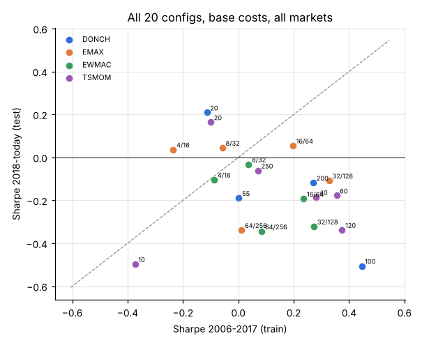
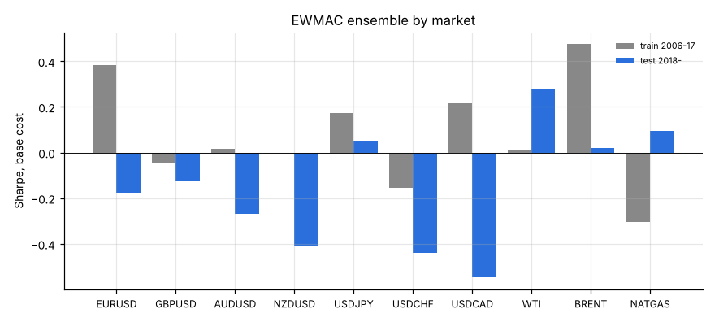
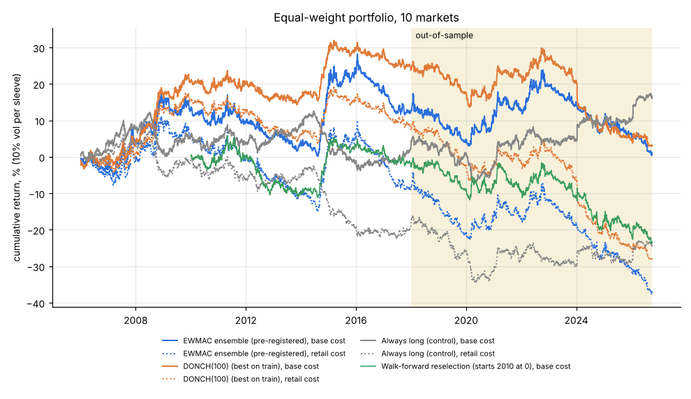

# Daily trend following: 10 markets, tuned 2006-2017, tested 2018-2026

Generated by `trend.py` (data through 2026-10-02). Every number below is
produced by the script; nothing was hand-edited. Raw tables are in `results/`.

## Verdict

**No robust edge out of sample, before or after costs.** In 2018-2026 the
pre-registered EWMAC ensemble made a Sharpe of -0.25 at base cost
(95% CI -0.86 to 0.37) and
-0.62 at retail CFD cost. The configuration that tuning
picked, `DONCH(100)`, did worse (-0.51), and so did walk-forward
reselection (-0.48). The zero-cost test Sharpe (-0.21) is
no better than randomly reshuffled price paths (p = 0.64), so this is
not a cost problem: the trend signal itself did not pay on these markets in this period.

* **In sample, the edge was small.** The best of 20 configs reached a train Sharpe of
  0.45. The expected best of 20 zero-skill configs is about
  0.42, so even the train result is barely
  distinguishable from selection luck (deflated-Sharpe probability 0.53).
  Most of it came from two years, 2008 and 2014.
* **Tuning hurt.** The train-test rank correlation is negative, and per-market tuning
  went from a train Sharpe of 0.80 to a test Sharpe of -0.51.
* **The only positive pockets are weak.** Energy was slightly positive (ensemble
  0.20), but energy spot data omit roll costs, which is what
  you would actually pay. Fast rules such as DONCH(20) and TSMOM(20) were mildly positive
  in test, but they lost money in train, so picking them now would be hindsight.
* **Retail costs are decisive.** At retail spreads plus financing, 0 of the 20
  configs are positive in test and 1 are positive in train.

(The prose in this section was written for the 10-market run committed here; the
numbers are computed. Re-read it if you add markets via `data/extra/`.)

This matches the prior 5-minute finding on Deriv synthetics, USD/CAD, EUR/USD and gold:
no edge after costs. The caveat is the universe. These are FX and energy markets only;
gold, silver and the equity indices were unavailable (see below), and those are where
trend following has historically done best.

## Data, and what is missing

Stooq and Yahoo were **blocked by the sandbox network policy** (HTTP 403 on
`stooq.com` and `query1.finance.yahoo.com`), so the study uses public mirrors:

| Market | Source | Notes |
|---|---|---|
| EURUSD, GBPUSD, AUDUSD, NZDUSD, USDJPY, USDCHF, USDCAD | FRED H.10 noon NY rates (github.com/datasets/exchange-rates) | spot only: **no carry/rollover** in returns |
| WTI, Brent | EIA spot (github.com/datasets/oil-prices) | spot, not futures: **no roll yield**; WTI spot printed -$36.98 in Apr-2020 |
| Henry Hub natural gas | EIA spot (github.com/datasets/natural-gas) | spot is not directly tradable; sparse before mid-2007, so it enters in 2008 |

**Gold, silver and the US indices are not in this run.** No free daily source
reaching 2026 was reachable (the only index data available ended in 2018).
`fetch_data.py` takes Stooq/Yahoo CSVs from `data/extra/` if you have them;
re-running `trend.py` then includes them automatically.

So this is 7 FX + 3 energy markets, not the 12 you asked for. It is light on the
asset classes (metals, equity indices) where trend following has historically
done best, so read the results as a test on FX and energy only.

## Method

* **Splits**: indicators warm up from 2004; **train 2006-01-01 → 2017-12-31**
  (12 years); **test 2018-01-01 → 2026-10-02** (~8.8 years). Nothing in the
  test window was used for any choice, including the EWMAC forecast scaling.
* **20 configurations, 4 families**: TSMOM(N) = sign of N-day return,
  N ∈ {10,20,40,60,120,250}; EMAX(f/4f) = sign of EMA crossover, f ∈ {4,8,16,32,64};
  EWMAC(f/4f) = the same crossover as a continuous, vol-normalised forecast, capped at ±2;
  DONCH(N) = N-day breakout, exit on an N/2-day opposite breakout, N ∈ {20,55,100,200}.
* **Pre-registered control**: `ENSEMBLE` = equal blend of EWMAC 8/32, 16/64,
  32/128, 64/256, fixed before looking at any result. It involves no selection, so it is
  the most honest out-of-sample estimate here. `LONG` (always long as quoted) is a
  drift control.
* **Sizing**: per-market vol targeting (EWMA-36 of daily price changes), 10% annual vol
  per sleeve at full forecast, equal-weight portfolio, 10% position buffer, 4x notional cap.
* **Execution**: signal at close t, P&L from t to t+1 (`lag 1`). `lag 2` adds a full
  extra day of delay.
* **Costs** (one-way, % of traded notional; financing is per year on gross notional):

| scenario | FX | oil | natgas | financing |
|---|---|---|---|---|
| zero | 0 | 0 | 0 | 0 |
| low (futures/ECN) | 0.5 bp | 2 bp | 5 bp | 0 |
| base (good retail) | 1.5 bp | 5 bp | 15 bp | 0 |
| retail (CFD / market maker, like Deriv) | 4 bp | 10 bp | 30 bp | 2%/yr |

## Headline: Sharpe ratios

| strategy | markets | train/zero | train/base | train/retail | test/zero | test/base | test/retail | test/base lag2 |
|---|---|---|---|---|---|---|---|---|
| ENSEMBLE | ALL | 0.21 | 0.18 | -0.12 | -0.21 | -0.25 | -0.62 | -0.29 |
| ENSEMBLE | FX | 0.16 | 0.13 | -0.18 | -0.36 | -0.39 | -0.79 | -0.40 |
| ENSEMBLE | ENERGY | 0.24 | 0.21 | 0.11 | 0.22 | 0.20 | 0.13 | 0.11 |
| DONCH(100) | ALL | 0.47 | 0.45 | 0.14 | -0.48 | -0.51 | -0.87 | -0.59 |
| DONCH(100) | FX | 0.37 | 0.36 | 0.04 | -0.48 | -0.50 | -0.91 | -0.54 |
| DONCH(100) | ENERGY | 0.38 | 0.36 | 0.27 | -0.15 | -0.16 | -0.21 | -0.26 |
| LONG | ALL | 0.08 | 0.07 | -0.42 | 0.40 | 0.39 | -0.18 | 0.43 |
| LONG | FX | -0.03 | -0.03 | -0.66 | -0.12 | -0.13 | -0.98 | -0.14 |
| LONG | ENERGY | 0.17 | 0.16 | 0.07 | 0.63 | 0.62 | 0.57 | 0.66 |

`DONCH(100)` is the configuration with the best train Sharpe (base cost, all markets) out of
the 20. Choosing it after seeing all 20 is what makes its train number optimistic.

Return, vol and drawdown (base cost, all markets; returns in fraction of capital):

| config | test ann_ret | train ann_ret | test ann_vol | train ann_vol | test maxdd | train maxdd | test t | train t |
|---|---|---|---|---|---|---|---|---|
| ENSEMBLE | -0.013 | 0.010 | 0.051 | 0.058 | -0.235 | -0.173 | -0.755 | 0.621 |
| DONCH(100) | -0.023 | 0.019 | 0.045 | 0.044 | -0.270 | -0.094 | -1.514 | 1.554 |
| LONG | 0.014 | 0.003 | 0.037 | 0.036 | -0.129 | -0.163 | 1.163 | 0.257 |

## Was the best train config any good out of sample?

Best configuration per family, chosen on train:

| config | family | train Sharpe | test Sharpe |
|---|---|---|---|
| DONCH(100) | DONCH | 0.45 | -0.51 |
| TSMOM(120) | TSMOM | 0.37 | -0.34 |
| EMAX(32/128) | EMAX | 0.33 | -0.11 |
| EWMAC(32/128) | EWMAC | 0.27 | -0.32 |

* Rank correlation (Spearman) of train vs test Sharpe across all 20 configs:
  **-0.42** (p = 0.07). Positive would mean tuning
  on the past helps; zero means it picks nothing useful; negative means the configs that
  looked best in 2006-2017 tended to do *worst* afterwards.
* Deflated Sharpe probability for `DONCH(100)` on train, adjusting for 20 trials:
  **0.53** (expected max Sharpe of 20 zero-skill trials ≈
  0.42).
* **Walk-forward** (each January, pick the best config on 2006 → last year, trade it for the
  year, base cost): Sharpe -0.30 over 2010 → today, **-0.48 over 2018 → today**.
* **Per-market tuning** (each market picks its own best config on train): train Sharpe
  0.80 → test Sharpe **-0.51**. This shows how much
  per-market tuning overfits:

| market | chosen | train_sharpe | test_sharpe |
|---|---|---|---|
| EURUSD | DONCH(100) | 0.65 | -0.39 |
| GBPUSD | TSMOM(120) | 0.36 | -0.39 |
| AUDUSD | TSMOM(40) | 0.44 | -0.64 |
| NZDUSD | TSMOM(60) | 0.25 | -0.50 |
| USDJPY | TSMOM(250) | 0.38 | 0.08 |
| USDCHF | DONCH(100) | 0.19 | -0.58 |
| USDCAD | EMAX(32/128) | 0.39 | -0.39 |
| WTI | TSMOM(60) | 0.37 | 0.01 |
| BRENT | DONCH(20) | 0.57 | 0.75 |
| NATGAS | DONCH(100) | 0.06 | -0.21 |

Walk-forward picks by year:

| year | pick | insample_sharpe | oos_sharpe |
|---|---|---|---|
| 2010 | DONCH(100) | 1.04 | -0.10 |
| 2011 | TSMOM(120) | 0.89 | 0.07 |
| 2012 | TSMOM(120) | 0.74 | -1.73 |
| 2013 | TSMOM(40) | 0.52 | -0.60 |
| 2014 | DONCH(100) | 0.45 | 2.64 |
| 2015 | DONCH(100) | 0.69 | 0.20 |
| 2016 | DONCH(100) | 0.64 | -0.09 |
| 2017 | DONCH(100) | 0.58 | -1.53 |
| 2018 | DONCH(100) | 0.45 | 0.17 |
| 2019 | DONCH(100) | 0.42 | -2.14 |
| 2020 | TSMOM(60) | 0.30 | 0.27 |
| 2021 | TSMOM(60) | 0.30 | -0.46 |
| 2022 | DONCH(100) | 0.31 | 0.89 |
| 2023 | DONCH(100) | 0.35 | -1.47 |
| 2024 | EMAX(32/128) | 0.27 | -1.18 |
| 2025 | TSMOM(60) | 0.20 | -0.70 |
| 2026 | EMAX(32/128) | 0.17 | -0.62 |

## Significance of the out-of-sample results

| test | ENSEMBLE | DONCH(100) |
|---|---|---|
| Test Sharpe, base cost | -0.25 | -0.51 |
| 95% CI (stationary block bootstrap, 20-day blocks) | [-0.86, 0.37] | [-1.19, 0.12] |
| Bootstrap P(Sharpe ≤ 0) | 0.80 | 0.94 |
| Zero-cost test Sharpe | -0.21 | -0.48 |
| Shuffled-path null: mean ± sd of Sharpe | -0.11 ± 0.35 | -0.06 ± 0.33 |
| Shuffled-path null: p-value (zero cost) | 0.637 | 0.900 |

The shuffled-path null re-runs the same rule on 300 test-period price paths whose daily
changes are randomly reordered (jointly across markets). That keeps the volatility, fat
tails and cross-correlation but removes any trend persistence. A small p-value means the
real paths trended more than chance would explain.

## Every configuration (all markets, lag 1)

Turnover is annual traded notional as a multiple of capital (test period). Break-even
is the one-way cost, in bp of notional across all markets, at which the test Sharpe
reaches zero.

| config | train/zero | train/base | train/retail | test/zero | test/base | test/retail | annual_turnover_x | breakeven_cost_bp_oneway |
|---|---|---|---|---|---|---|---|---|
| TSMOM(10) | -0.10 | -0.37 | -1.13 | -0.22 | -0.50 | -1.32 | 72.41 | -1.48 |
| TSMOM(20) | 0.09 | -0.10 | -0.73 | 0.35 | 0.16 | -0.52 | 51.02 | 3.45 |
| TSMOM(40) | 0.41 | 0.28 | -0.25 | -0.04 | -0.19 | -0.79 | 40.15 | -0.54 |
| TSMOM(60) | 0.47 | 0.35 | -0.15 | -0.06 | -0.18 | -0.75 | 33.14 | -0.88 |
| TSMOM(120) | 0.45 | 0.37 | -0.07 | -0.25 | -0.34 | -0.88 | 24.28 | -5.09 |
| TSMOM(250) | 0.14 | 0.07 | -0.37 | 0.01 | -0.06 | -0.58 | 19.92 | 0.35 |
| EMAX(4/16) | -0.08 | -0.23 | -0.81 | 0.19 | 0.04 | -0.59 | 40.02 | 2.32 |
| EMAX(8/32) | 0.02 | -0.06 | -0.52 | 0.13 | 0.04 | -0.47 | 22.16 | 2.92 |
| EMAX(16/64) | 0.24 | 0.20 | -0.21 | 0.10 | 0.05 | -0.41 | 12.16 | 4.19 |
| EMAX(32/128) | 0.35 | 0.33 | -0.05 | -0.08 | -0.11 | -0.55 | 7.78 | -5.17 |
| EMAX(64/256) | 0.03 | 0.01 | -0.37 | -0.32 | -0.34 | -0.78 | 5.26 | -30.25 |
| EWMAC(4/16) | 0.05 | -0.09 | -0.55 | 0.03 | -0.10 | -0.60 | 47.26 | 0.41 |
| EWMAC(8/32) | 0.11 | 0.04 | -0.32 | 0.04 | -0.03 | -0.45 | 25.68 | 1.03 |
| EWMAC(16/64) | 0.28 | 0.24 | -0.07 | -0.15 | -0.19 | -0.57 | 14.76 | -6.17 |
| EWMAC(32/128) | 0.30 | 0.27 | -0.01 | -0.29 | -0.32 | -0.68 | 9.11 | -18.48 |
| EWMAC(64/256) | 0.10 | 0.08 | -0.20 | -0.32 | -0.34 | -0.69 | 6.28 | -27.17 |
| DONCH(20) | -0.01 | -0.11 | -0.56 | 0.31 | 0.21 | -0.27 | 23.73 | 5.74 |
| DONCH(55) | 0.04 | 0.00 | -0.33 | -0.14 | -0.19 | -0.59 | 10.30 | -6.02 |
| DONCH(100) | 0.47 | 0.45 | 0.14 | -0.48 | -0.51 | -0.87 | 6.63 | -32.68 |
| DONCH(200) | 0.28 | 0.27 | -0.04 | -0.10 | -0.12 | -0.46 | 3.51 | -11.87 |
| ENSEMBLE | 0.21 | 0.18 | -0.12 | -0.21 | -0.25 | -0.62 | 11.50 | -9.38 |
| LONG | 0.08 | 0.07 | -0.42 | 0.40 | 0.39 | -0.18 | n/a | n/a |

## By market

| market | ENSEMBLE train | ENSEMBLE test | DONCH(100) train | DONCH(100) test | LONG train | LONG test |
|---|---|---|---|---|---|---|
| EURUSD | 0.38 | -0.18 | 0.65 | -0.39 | 0.08 | -0.22 |
| GBPUSD | -0.04 | -0.13 | 0.25 | 0.01 | -0.13 | -0.17 |
| AUDUSD | 0.02 | -0.27 | -0.12 | -0.45 | -0.02 | -0.24 |
| NZDUSD | 0.00 | -0.41 | 0.02 | -0.73 | -0.02 | -0.35 |
| USDJPY | 0.17 | 0.05 | 0.22 | 0.23 | 0.12 | 0.45 |
| USDCHF | -0.16 | -0.44 | 0.19 | -0.58 | -0.28 | -0.20 |
| USDCAD | 0.22 | -0.55 | 0.28 | -0.37 | 0.18 | 0.43 |
| WTI | 0.01 | 0.28 | 0.27 | 0.15 | 0.16 | 0.07 |
| BRENT | 0.47 | 0.02 | 0.39 | -0.18 | 0.14 | 0.25 |
| NATGAS | -0.30 | 0.10 | 0.06 | -0.21 | 0.02 | 0.75 |

## Year by year (base cost, all markets, % of capital)

| year | ENSEMBLE % | DONCH(100) % | LONG % |
|---|---|---|---|
| 2006 | -1.9 | 0.2 | 4.3 |
| 2007 | 5.8 | 3.6 | 3.5 |
| 2008 | 11.2 | 13.5 | -6.6 |
| 2009 | -2.3 | 3.4 | 4.6 |
| 2010 | -2.1 | -0.4 | -1.5 |
| 2011 | -1.2 | -0.0 | -0.8 |
| 2012 | -3.9 | -3.5 | 2.4 |
| 2013 | -1.4 | -0.1 | 3.0 |
| 2014 | 15.0 | 11.9 | -5.3 |
| 2015 | 3.8 | 0.9 | -5.0 |
| 2016 | -4.2 | -0.3 | 0.6 |
| 2017 | -6.3 | -5.3 | 3.8 |
| 2018 | -0.9 | 0.8 | -2.3 |
| 2019 | -6.8 | -6.8 | 0.1 |
| 2020 | 6.7 | 2.0 | -3.4 |
| 2021 | 1.0 | 2.1 | 5.8 |
| 2022 | 6.9 | 5.0 | 1.1 |
| 2023 | -4.3 | -5.7 | 0.0 |
| 2024 | -5.3 | -12.0 | 4.5 |
| 2025 | -3.6 | -4.0 | 1.0 |
| 2026 | -5.3 | -1.9 | 6.2 |

## Caveats

* Spot FX excludes interest-rate carry. A real FX position earns or pays the rate
  differential, and from 2022 that is several % a year on USDJPY and the AUD/NZD pairs.
  Trend positions often line up with carry, so spot P&L understates or overstates them
  by period. The `retail` scenario's 2% financing is a generic broker markup on top of carry,
  not the carry itself.
* Energy spot prices are not what you trade. Futures and CFDs on them pay roll (contango)
  or earn it (backwardation), and natural gas spot jumps cannot be captured by front-month
  futures. Read the energy results as indicative only.
* FRED rates are noon New York fixes, not closes, so `lag 1` is realistic. `lag 2` tests
  slower execution.
* 10 markets is a small universe. Trend following's historical Sharpe (~0.5-1 before
  fees) comes largely from diversifying across 50-100+ futures. With 10 correlated markets
  (the 7 FX pairs share USD), one expects a lower and noisier Sharpe.
* EWMAC forecast scalars (fitted on train only): 4: 0.926, 8: 0.661, 16: 0.469, 32: 0.330, 64: 0.240.
